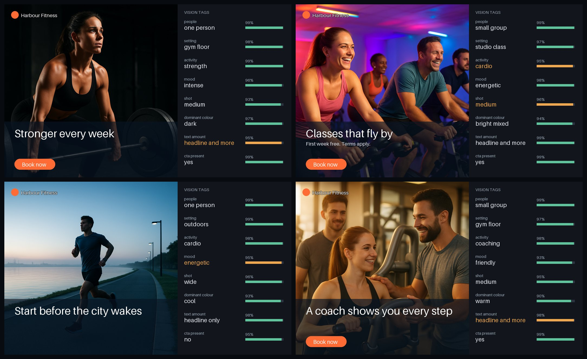
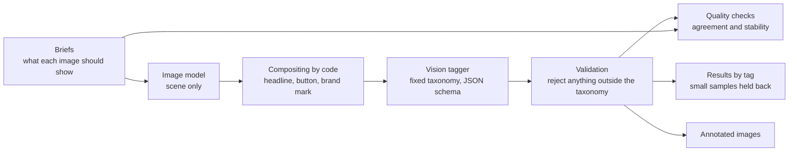

# creative-tagger

A vision model looks at every ad image and tags it against a fixed list of attributes. The tags are then checked, and results are broken down by tag.

Most ad accounts can tell you which ad won. Few can tell you what the winners have in common, because nobody wrote down what is in each picture. This project does that writing down, and then asks how far the tags can be trusted.

Related interactive concept on [mertatalay.com](https://mertatalay.com): [Creative Experiment Memory](https://mertatalay.com/lab/creative-experiment-memory/).



*Four of the twelve sample ads with their tags. Orange marks a tag that differs from what the image was made to show.*

**What is real here and what is not.** The twelve ads are for an invented gym brand, "Harbour Fitness". The scenes were generated by an image model; the headline, button and brand mark were placed by code. The tags and the quality numbers below are real output from a real vision model run in November 2026. The click numbers used in the by-tag table are invented, to show the analysis. This is an example of an approach, not a production system. It follows the shape of a tagging system I run in my work, rebuilt from scratch.

## How it works



1. **Taxonomy.** Eight fields, each with a closed list of values: people, setting, activity, mood, shot, dominant colour, text amount, call to action. It lives in one file, [`tagger/taxonomy.py`](tagger/taxonomy.py). The prompt and the JSON schema are both built from it, so they cannot drift apart.
2. **Tagging.** Each image goes to a vision model with the prompt and the schema. The model must answer every field with an allowed value and a confidence. It is told to judge only what is visible and not to guess identity, age or any personal trait.
3. **Validation.** A response with a value outside the taxonomy, a missing field or an extra field is dropped and recorded.
4. **Quality checks.** Two of them, described below.
5. **Results by tag.** Impressions and clicks are grouped by tag value. Each group's click rate is pulled toward the overall rate in proportion to how little data it has, and any value seen on fewer than three ads is flagged.
6. **Annotated images.** Each ad is drawn with its tags beside it.

## What the tagger got right and wrong

Each sample image was generated from a brief that says what it should show. That gives something to check against without anyone labelling by hand: does the tagger recover what was asked for? Each image was also tagged twice, to see if the answer changes.

I ran it twice. After the first run I changed one definition and ran it again.

| Field | Run 1 | Run 2 |
| --- | --- | --- |
| people | 12/12 | 12/12 |
| setting | 10/12 | 10/12 |
| activity | 10/12 | 9/12 |
| mood | 9/12 | 10/12 |
| shot | 9/12 | 8/12 |
| dominant colour | 11/12 | 11/12 |
| text amount | 4/12 | 7/12 |
| cta present | 12/12 | 12/12 |
| **All fields** | **77/96 (80%)** | **79/96 (82%)** |
| Same answer on both passes | 93% | 92% |

What I take from this:

- **Concrete things are easy.** People and call-to-action button were right every time.
- **A vague definition shows up as a bad score.** "Text amount" scored 4 of 12 in the first run. The model was counting the brand name and the button as text. I added one sentence to the definition and it rose to 7 of 12. It still treats a button as extra text on some ads, so the definition needs more work. This is the reason to measure before trusting a field.
- **Some misses are the brief's fault.** A spin class was tagged "cardio" where the brief said "class". A yoga studio that the image model drew like a living room was tagged "home". The tagger described the picture; the brief described the intention.
- **Judgement fields are softer.** Mood and shot are matters of degree, and they scored lower.
- **Confidence does not flag the errors.** Across both runs the wrong tags came with confidence of 0.72 to 0.99, as high as most of the right ones. I would not use the model's own confidence as a filter.
- **Tags are not perfectly stable.** About one field in thirteen changed between two passes on the same image.

Twelve images is a small test. These numbers show the method, not the model's general accuracy.

## Results by tag

With invented click numbers, the "people" field from run 2 looks like this:

| People | Ads | Click rate | Lift after shrinkage | Enough data |
| --- | --- | --- | --- | --- |
| crowd | 1 | 0.97% | 0.84 | no, too few ads |
| none | 2 | 0.98% | 0.80 | no, too few ads |
| one person | 6 | 1.52% | 1.10 | yes |
| small group | 3 | 1.46% | 1.05 | yes |

The generator plants one effect: ads with one person or a small group get more clicks. The table recovers it, and it marks the two values that rest on one or two ads as too thin to read. With twelve ads, most tag values are too thin. That is the honest state of most creative analysis, and the flag is there to say so.

## Run it

You need Python 3.12 or newer and [uv](https://docs.astral.sh/uv/).

```bash
uv sync
uv run pytest
```

The tests and the report make no API calls. To rebuild the report from the committed run:

```bash
mkdir -p out && cp results/run2/tags.json out/
uv run python -m tagger report
```

To tag images yourself you need an API key. Keys are read from the environment and sent in a header.

```bash
export OPENAI_API_KEY=...                      # or GEMINI_API_KEY
TAGGER_VISION_MODEL=gpt-5.4-mini uv run python -m tagger tag --passes 2 --max-calls 24
```

`python -m tagger samples` regenerates the sample scenes with an image model. Set `TAGGER_IMAGE_MODEL` to choose it. A model name starting with `gpt-` uses the OpenAI API; anything else uses the Gemini API.

Every command that calls a model takes `--max-calls` and stops when it is reached. Image generation is never retried. The committed run used 12 image calls and 48 tagging calls.

## Which models were used

- Scenes: `gpt-image-1-mini`.
- Tags: `gpt-5.4-mini`, with the images sent at low detail.

The Gemini client is in the code and covered by the budget and missing-key tests, but the committed results were not produced with it. When I ran this, the Gemini models on my key were returning "busy" errors, so I used the OpenAI ones.

## Limits

- **Twelve images, one brand, one model.** No comparison between models.
- **The reference is the brief, not a person.** A brief says what was asked for, not what is in the picture. A proper calibration set is a few dozen real ads labelled by two people, with their agreement measured first.
- **Click numbers are invented.** The by-tag table shows the calculation and nothing about real ads.
- **No statistics beyond shrinkage and a minimum count.** No confidence intervals, no correction for looking at many tags at once, no control for spend, audience or placement. Real analysis needs those.
- **Still images only.** No video.
- **The overlay text uses a default font,** so the sample ads look plainer than designed ones.
- **The Gemini path has not produced results here,** as noted above.
- **No storage, no schedule, no embeddings.** It reads a folder and writes JSON.

## Layout

```
briefs/briefs.json     what each sample image should show
samples/ads/           the twelve composed sample ads (stored at 768 pixels)
tagger/taxonomy.py     the tag schema, prompt and validation
tagger/client.py       Gemini and OpenAI clients with a call budget
tagger/samples.py      scene generation and compositing
tagger/run.py          tagging passes
tagger/quality.py      agreement and stability
tagger/analysis.py     results by tag
tagger/annotate.py     annotated images
results/run1, run2     tags and reports from the two real runs
tests/
```

## License

MIT. See [LICENSE](LICENSE).
